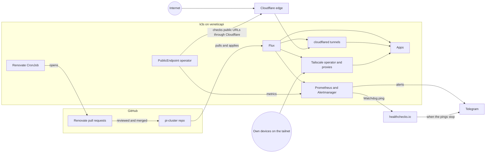

# pi-cluster

My homelab: a single-node Kubernetes cluster (k3s) on a Raspberry Pi with 4 GB of RAM.
Everything that runs on it comes from this repository through Flux. I try to run it the way
I'd want a real cluster to be run: secrets encrypted in Git, alerts on my phone, updates as
pull requests I actually review, and every decision and incident written down.

You can see it running at [status.matveeva.dev](https://status.matveeva.dev).

## How this started

I started in July by deploying a few apps and breaking a lot of things along the way (the
early commit history shows it). After a break I picked it up again in October with a
different goal: run it properly and document everything that is happening with my cluster, with my explanation. This approach helped me to notice the same week how the node's disk was filled up with old images, and to find out that Grafana rollout had been stuck for 71 days without anyone noticing. That's why I decided to implement alerting and documentation, so I would be able to catch such issues early before they become problems.

## How it fits together

Nothing on the node listens on ports 80 or 443. Public apps go out through Cloudflare
tunnels, and private apps are only reachable from my own devices on the tailnet, through the
Tailscale operator.

## What runs on it

- cluster-status, the public status page. It's my own small app
  ([repo](https://github.com/imatveeva250/cluster-status)) and only asks Prometheus for a few
  fixed numbers.
- audiobookshelf, an audiobook server. Public through a tunnel, and also on the tailnet.
- Vaultwarden, my password manager. Tailnet only.
- Forgejo, a Git server. Tailnet only. It's empty for now: I'm keeping it for running CI
  inside the cluster later.
- Grafana, for dashboards. Tailnet only.

The platform underneath: k3s with Traefik, ServiceLB and its built-in Helm controller turned
off ([0004](docs/decisions/0004-disable-traefik-servicelb.md)), Flux, SOPS with age for
secrets, the Tailscale operator for private access
([0007](docs/decisions/0007-tailscale-operator-flux.md)), cloudflared for public access,
kube-prometheus-stack for monitoring, and Renovate for dependency updates.

There's also the PublicEndpoint operator, which checks from inside the cluster that my
public URLs work from the outside. I wrote it mostly to learn how operators work (custom
resources, a reconcile loop, scoped RBAC); the blackbox exporter would do the same job.
More about that in [its repo](https://github.com/imatveeva250/publicendpoint-operator) and
[0003](docs/decisions/0003-publicendpoint-operator.md).

## How I run it

Nothing in the cluster is installed by hand anymore, Flux applies everything from this repo.

Every app has probes and memory limits, and so does the monitoring stack. I set them from at
least a week of Prometheus data, not guesses. There are no CPU limits on purpose - the CPU is mostly idle, and limits would only throttle apps during short bursts. Memory is what runs out on this node, so that's where the limits are present in every app.

Alerts go to a Telegram bot. They repeat while a problem lasts, and I get a message when it's
resolved ([0005](docs/decisions/0005-alerting-telegram.md)). Most of the rules come with
kube-prometheus-stack; I added my own only for the gaps, like swap, my public endpoints and
Flux objects that stop being Ready ([0006](docs/decisions/0006-flux-alerts-kube-state-metrics.md)).
If the whole cluster goes quiet, healthchecks.io notices and tells me
from outside.

If GitHub is down, the cluster keeps running the last revision Flux fetched; only changes
wait until it's back ([2026-11-04](docs/postmortems/2026-11-04-github-outage.md)).

Vaultwarden is backed up every night to Cloudflare R2 with restic, encrypted before it leaves
the Pi ([0008](docs/decisions/0008-backups-restic-r2.md)). A backup I never restored is only a hope, so I
deleted its PVC on purpose and brought it back ([runbook](docs/runbooks/restore-a-pvc.md)). The
first try failed, and the runbook now has the checks that would have stopped me.

My mistakes in YAML (a missing dash, a wrong file name) used to show up only when Flux failed on the live cluster. Now a small script lints the apps and checks them against the Kubernetes schemas. I run it before pushing, and GitHub Actions runs it again on every push ([0009](docs/decisions/0009-ci-github-actions.md)). For now it only covers the apps.

Renovate opens a pull request for every new image or chart version. I read them before
merging, and for bigger Helm chart upgrades I render the old and the new chart with my own
values and compare the output first.

When something goes wrong, I write a postmortem. When I make a decision that matters, I
write it down as an ADR. When a security advisory comes out, I check whether it affects me
and record what I did in the table at the end.

## Repository layout

| Path | What's in it |
|---|---|
| `clusters/staging` | Where Flux starts: the Kustomizations below, and Flux itself (`flux-system`) |
| `infrastructure/controllers` | Renovate, the PublicEndpoint operator and the Tailscale operator |
| `monitoring/controllers` | The kube-prometheus-stack HelmRelease and its secrets |
| `monitoring/configs` | My own alert rules |
| `apps/base` | The base manifests for each app |
| `apps/staging` | Per app: ingress, tunnel, public endpoint check, backup CronJob, secrets |
| `docs/decisions` | Architecture decision records |
| `docs/postmortems` | Incident write-ups |
| `docs/runbooks` | Step-by-step procedures I have tested |
| `scripts/check.sh` | The checks CI runs on every push; I run them before pushing too |
| `.github/workflows` | The GitHub Actions workflow that runs `scripts/check.sh` |
| `renovate.json` | Renovate settings |

Flux applies it as four Kustomizations, in this order:

| Kustomization | Path | Depends on |
|---|---|---|
| `infrastructure-controllers` | `infrastructure/controllers/staging` | |
| `apps` | `apps/staging` | `infrastructure-controllers` |
| `monitoring-controllers` | `monitoring/controllers/staging` | (waits until its HelmRelease is ready) |
| `monitoring-configs` | `monitoring/configs/staging` | `monitoring-controllers` |

## Decisions

| # | Decision | Summary |
|---|---|---|
| [0001](docs/decisions/0001-forgejo-setup.md) | Forgejo setup | 15 LTS, Tailscale only, rootless image, SQLite |
| [0002](docs/decisions/0002-cluster-status.md) | Cluster status page | Own app, fixed Prometheus queries, arm64 image via GitHub Actions, public through its own tunnel |
| [0003](docs/decisions/0003-publicendpoint-operator.md) | PublicEndpoint operator | Own CRD and kopf operator, scoped RBAC, endpoints declared per app |
| [0004](docs/decisions/0004-disable-traefik-servicelb.md) | Disable Traefik, ServiceLB and the k3s Helm controller | No ingress controller on the node; all k3s settings in `config.yaml` |
| [0005](docs/decisions/0005-alerting-telegram.md) | Alert delivery through Telegram | Telegram bot, token via SOPS file; Watchdog to healthchecks.io as a dead man's switch |
| [0006](docs/decisions/0006-flux-alerts-kube-state-metrics.md) | Flux resource alerts through kube-state-metrics | Flux `Ready` conditions as metrics, alert after 15 minutes not Ready |
| [0007](docs/decisions/0007-tailscale-operator-flux.md) | Manage the Tailscale operator with Flux | Hand-installed release adopted without proxy restarts; OAuth values from SOPS through `valuesFrom` |
| [0008](docs/decisions/0008-backups-restic-r2.md) | Backups with restic to Cloudflare R2 | Nightly CronJob per app, consistent SQLite copy, encrypted snapshots off-site, healthchecks.io ping; restore tested |
| [0009](docs/decisions/0009-ci-github-actions.md) | Repository checks with GitHub Actions | yamllint, kustomize build and kubeconform on the apps, on every push |

## Postmortems

| Date | Incident |
|---|---|
| [2026-10-22](docs/postmortems/2026-10-22-renovate-images.md) | Node disk filled by unpinned Renovate images |
| [2026-10-22](docs/postmortems/2026-10-22-grafana-stuck-rollout.md) | Grafana rollout stuck for 71 days on a missing Secret key |
| [2026-11-04](docs/postmortems/2026-11-04-github-outage.md) | Flux could not fetch from GitHub during a GitHub outage |

## Runbooks

| Runbook | When to use it |
|---|---|
| [Restore a PVC](docs/runbooks/restore-a-pvc.md) | A PVC is deleted or its data is broken; tested with Vaultwarden on 2026-11-10 |

## Security advisories

| Advisory | Published | Affected here | Response | Status |
|---|---|---|---|---|
| eMudhra intermediate CA key compromise | 2026-10-20 | cloudflared (both tunnels); the node's CA store; images with their own CA store (cluster-status, publicendpoint-operator); Flux | cloudflared upgraded to 2026.10.2, then 2026.10.5; node `ca-certificates` updated; cluster-status and publicendpoint-operator rebuilt on a current Python base image; Flux upgraded to 2.10.0 (Go 1.27.3) | Mitigated |
| Tailworm (Tailscale SSH and serve flaws, no upstream fix) | 2026-10-25 | Tailscale on the node and the operator proxies | Verified that Tailscale SSH is off on every node and proxy and that no serve forward points at a Unix socket; removed the default Tailscale SSH policy rule | Not exposed |
