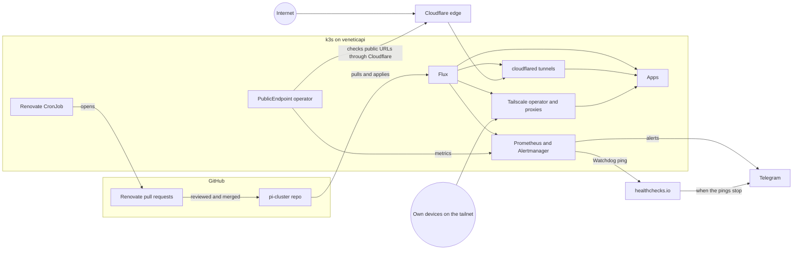

# pi-cluster

A single-node Kubernetes (k3s) homelab on a Raspberry Pi with 4 GB of RAM, run the way a
production cluster would be: everything comes from this repository through GitOps (Flux),
secrets are encrypted in Git, alerts reach a phone, dependency updates arrive as reviewed
pull requests, and every decision and incident is written down.

Live: [status.matveeva.dev](https://status.matveeva.dev) shows the cluster's current numbers,
served by an app from this repository.

## Architecture

Nothing on the node listens on ports 80 or 443. Public apps are reached through outbound Cloudflare tunnels; private apps only from devices on
the tailnet.

## What runs here

| App | Purpose | Access |
|---|---|---|
| cluster-status | Public page with live cluster numbers from Prometheus ([own code](https://github.com/imatveeva250/cluster-status)) | Public, Cloudflare tunnel |
| audiobookshelf | Audiobook server | Public, Cloudflare tunnel; private, Tailscale |
| Vaultwarden | Password manager | Private, Tailscale |
| Forgejo | Git hosting | Private, Tailscale |
| Grafana | Dashboards | Private, Tailscale |

## Platform

| Component | Role |
|---|---|
| k3s | Kubernetes distribution. Traefik, ServiceLB and the built-in Helm controller are disabled ([0004](docs/decisions/0004-disable-traefik-servicelb.md)) |
| Flux | Applies this repository to the cluster and runs the Helm releases |
| SOPS with age | Encrypts Secrets in Git; Flux decrypts them in the cluster |
| Tailscale operator | Private access: one tailnet device per Tailscale Ingress ([0007](docs/decisions/0007-tailscale-operator-flux.md)) |
| cloudflared | Public access: one Cloudflare tunnel per public app |
| kube-prometheus-stack | Prometheus, Alertmanager, Grafana, the default alert rules and custom ones for the gaps |
| PublicEndpoint operator | Own Kubernetes operator: a `PublicEndpoint` custom resource per public URL, checked from inside the cluster and exported as metrics ([own code](https://github.com/imatveeva250/publicendpoint-operator), [0003](docs/decisions/0003-publicendpoint-operator.md)) |
| Renovate | Opens pull requests for new image tags and Helm chart versions |

## How it is operated

- **Git is the only way in.** Changes are commits; Flux applies them within a minute and prunes
  what was removed. `helm list -A` and `flux get helmreleases -A` show the same releases:
  nothing is installed by hand.
- **Every app has probes and memory limits**, and the monitoring stack has memory limits,
  sized from at least seven days of Prometheus data. There are no CPU limits on purpose. Memory is the bottleneck on this node.
- **Alerts reach a phone.** Alertmanager sends to a Telegram bot, with repeats while an alert
  lasts and a message when it resolves ([0005](docs/decisions/0005-alerting-telegram.md)).
  A dead man's switch on healthchecks.io raises an alert from outside when the cluster stops
  reporting. Flux objects that stop being Ready alert too
  ([0006](docs/decisions/0006-flux-alerts-kube-state-metrics.md)).
- **Dependency updates are reviewed, not just merged.** Renovate proposes them; Helm chart
  upgrades are checked by rendering the old and new chart with the release's own values and
  diffing the result before merging.
- **Decisions and incidents are documented**: architecture decision records, postmortems, and
  a table of security advisories with what was checked and changed.

## Repository layout

| Path | Contents |
|---|---|
| `clusters/staging` | Flux entry point: the Kustomizations below and Flux itself (`flux-system`) |
| `infrastructure/controllers` | Cluster-wide controllers: Renovate, PublicEndpoint operator, Tailscale operator |
| `monitoring/controllers` | kube-prometheus-stack HelmRelease and its secrets |
| `monitoring/configs` | Custom alert rules (`PrometheusRule`) |
| `apps/base` | Base manifests per app |
| `apps/staging` | Overlays per app: ingress, tunnel, public endpoint check, secrets |
| `docs/decisions` | Architecture decision records |
| `docs/postmortems` | Incident write-ups |
| `renovate.json` | Renovate configuration |

Flux applies the tree as four Kustomizations, in dependency order:

| Kustomization | Path | Depends on |
|---|---|---|
| `infrastructure-controllers` | `infrastructure/controllers/staging` | |
| `apps` | `apps/staging` | `infrastructure-controllers` |
| `monitoring-controllers` | `monitoring/controllers/staging` | (waits until its HelmRelease is ready) |
| `monitoring-configs` | `monitoring/configs/staging` | `monitoring-controllers` |

## Bootstrap

1. Install k3s with `/etc/rancher/k3s/config.yaml` disabling `traefik` and `servicelb` and
   setting `disable-helm-controller: true` ([0004](docs/decisions/0004-disable-traefik-servicelb.md)).
2. Create the age key Secret that Flux uses to decrypt:
   `kubectl create namespace flux-system` and
   `kubectl create secret generic sops-age -n flux-system --from-file=age.agekey=<path to the age key>`.
   The key itself is never committed (`*.agekey` is in `.gitignore`).
3. Bootstrap Flux against this repository with the path `clusters/staging`
   (`flux bootstrap github --owner=imatveeva250 --repository=pi-cluster --branch=main --path=clusters/staging --personal`).
4. Flux applies everything else. Tailscale proxies register new devices, so old devices with
   the same names must be removed in the Tailscale admin console first, or the new ones get
   suffixed names.

## Decisions

| # | Decision | Summary |
|---|---|---|
| [0001](docs/decisions/0001-forgejo-setup.md) | Forgejo setup | 15 LTS, Tailscale only, rootless image, SQLite |
| [0002](docs/decisions/0002-cluster-status.md) | Cluster status page | Own app, fixed Prometheus queries, arm64 image via GitHub Actions, public through its own tunnel |
| [0003](docs/decisions/0003-publicendpoint-operator.md) | PublicEndpoint operator | Own CRD and kopf operator, scoped RBAC, endpoints declared per app |
| [0004](docs/decisions/0004-disable-traefik-servicelb.md) | Disable Traefik, ServiceLB and the k3s Helm controller | No ingress controller on the node; all k3s settings in `config.yaml` |
| [0005](docs/decisions/0005-alerting-telegram.md) | Alert delivery through Telegram | Telegram bot, token via SOPS file; Watchdog to healthchecks.io as a dead man's switch |
| [0006](docs/decisions/0006-flux-alerts-kube-state-metrics.md) | Flux resource alerts through kube-state-metrics | Flux `Ready` conditions as metrics, alert after 15 minutes not Ready |
| [0007](docs/decisions/0007-tailscale-operator-flux.md) | Manage the Tailscale operator with Flux | Hand-installed release adopted without proxy restarts; OAuth values from SOPS through `valuesFrom` |

## Postmortems

| Date | Incident |
|---|---|
| [2026-10-22](docs/postmortems/2026-10-22-renovate-images.md) | Node disk filled by unpinned Renovate images |
| [2026-10-22](docs/postmortems/2026-10-22-grafana-stuck-rollout.md) | Grafana rollout stuck for 71 days on a missing Secret key |

## Security advisories

| Advisory | Published | Affected here | Response | Status |
|---|---|---|---|---|
| eMudhra intermediate CA key compromise | 2026-10-20 | cloudflared (both tunnels); the node's CA store; images with their own CA store (cluster-status, publicendpoint-operator); Flux | cloudflared upgraded to 2026.10.2, then 2026.10.5; node `ca-certificates` updated | Partially mitigated: own images and Flux not yet updated |
| Tailworm (Tailscale SSH and serve flaws, no upstream fix) | 2026-10-25 | Tailscale on the node and the operator proxies | Verified that Tailscale SSH is off on every node and proxy and that no serve forward points at a Unix socket; removed the default Tailscale SSH policy rule | Not exposed |
